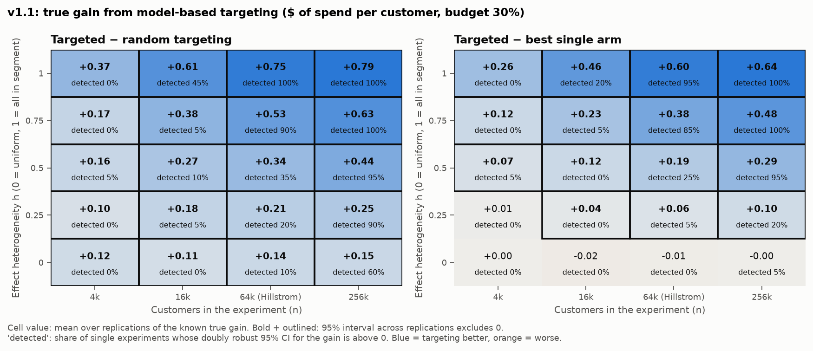
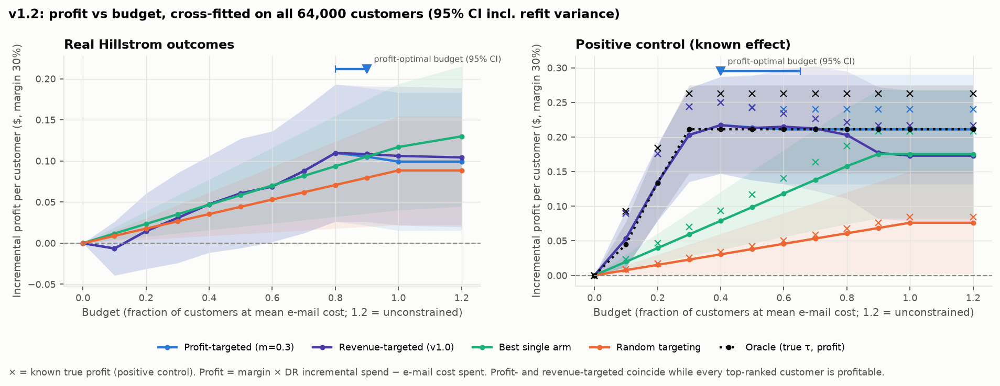
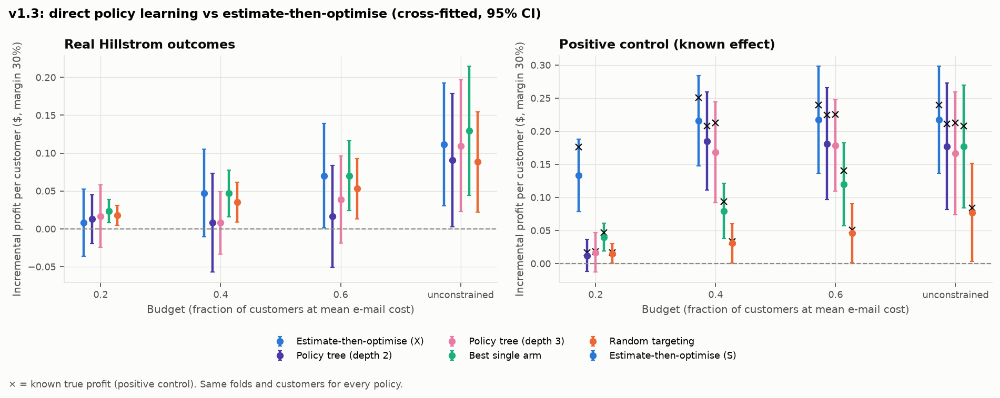
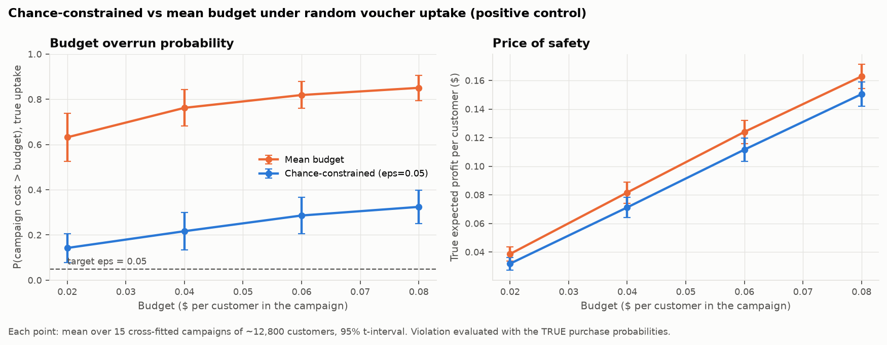
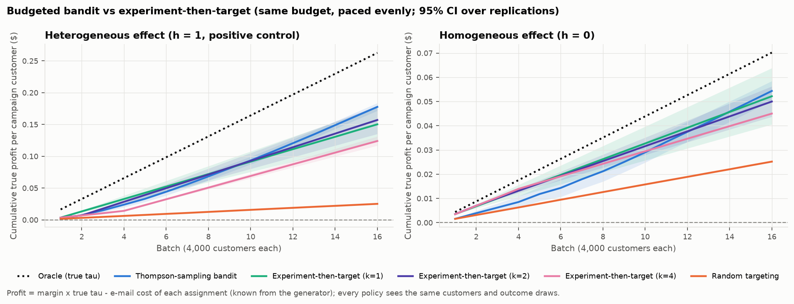
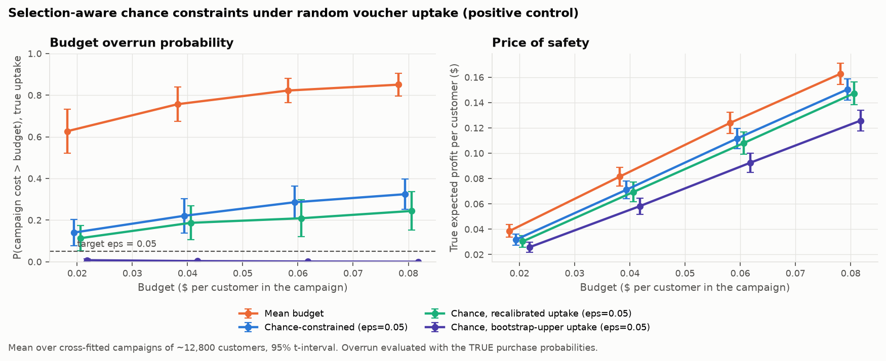

# When Does Uplift Targeting Pay Off?

**Paper:** [paper/main.pdf](paper/main.pdf)

[](https://github.com/GrafZemeliSeverochecanskih/budget-uplift/actions/workflows/tests.yml)

**v1.0: a pre-registered pipeline, extended in later releases.** Each release freezes its config in
a commit before anything runs on it; the plan is in [ROADMAP.md](ROADMAP.md) and every later change
is logged with a reason in [DECISIONS.md](DECISIONS.md).

| Release | Question | Finding |
|---|---|---|
| v1.0 | Does uplift targeting beat simple rules on Hillstrom? | No for spend; a small signal for visit that does not beat "Mens e-mail for everyone". A positive control is recovered. |
| [v1.1](#v11---when-does-targeting-pay-off) | When does targeting pay off? | Gains appear from modest heterogeneity, but at Hillstrom's size one experiment rarely detects them. The null is weak evidence. |
| [v1.2](#v12---profit-objective) | What if we maximise profit and pick the budget? | The profit objective finds its own budget (known optimum recovered); real data: e-mailing pays, targeting does not. Cross-fitting narrows intervals by 37-58%. |
| [v1.3](#v13---direct-policy-learning-and-a-chance-constrained-budget) | Policy learning? Random uptake? | Policy trees never beat estimate-then-optimise. Chance constraints cut overruns but miss their target because of the optimiser's curse. |
| [v1.4](#v14---sequential-allocation-bandit-vs-experiment-then-target) | Learn while spending? | A Thompson-sampling bandit beats experiment-then-target with k = 1 and k = 4 and is not significantly different from k = 2, and costs nothing when there is nothing to learn. |
| [v1.5](#v15---selection-aware-chance-constraint) | Can the chance constraint be repaired? | Recalibrating uptake on held-out selected customers barely helps; a bootstrap-upper uptake bound meets the 5% target with room to spare, at 16-19% of profit. |

**Question.** A retailer can afford to e-mail only some customers, and has two e-mails (Mens, Womens)
of different cost. Can heterogeneous treatment effects estimated from a randomised experiment pick
*who* gets *which* e-mail better than simple rules, at every budget?

**Answer, in two parts.**

1. **On the real Hillstrom data there is no usable targeting signal for spend.** None of five uplift
   learners ranks customers better than random on 2-week spend. The model-targeted policy is
   indistinguishable from random targeting, and its point estimate is *below* the rule "send the Mens
   e-mail to a random subset" at every budget. For **visit** there is a real but small signal. All
   learners rank the Womens-e-mail effect better than random (p = 0.004), and the visit-targeted
   policy beats random targeting at 7 of 10 budgets. It beats the Mens rule at only 1 of 10.
2. **The pipeline would have found a signal if one existed.** As a positive control, I kept the real
   covariates, real arm assignment and real split, and simulated outcomes with a known effect: the
   Womens e-mail adds $3 of expected spend, but only for a segment covering 32% of customers. Noise
   is realistic (1% buy, heavy-tailed amounts). The *unchanged* pipeline then recovers the true effect
   with tau-hat vs tau correlation 0.62-0.83 for spend and 0.90-0.96 for visit. It beats random targeting at
   8 of 10 budgets for spend and 10 of 10 for visit, and at every budget it reaches 90-98% (spend)
   and 93-99% (visit) of the true value of an oracle policy that knows tau.

So the spend null result is a property of the data, not a blind spot of the method. The optimisation
layer works on both: a Lagrangian heuristic stays within 0.34% of the exact integer program and is
~170x faster at 64k customers.

Pipeline: RCT analysis -> CATE/uplift models -> allocation under a budget (integer program and
Lagrangian) -> off-policy evaluation (IPW and doubly robust). Extensions: semi-synthetic positive
control, deliberate confounding, lower-confidence-bound allocation, and LLM-embedding features.

## Data

[Hillstrom MineThatData e-mail RCT](DATA_CARD.md): 64,000 customers randomised in equal thirds to a
Mens e-mail, a Womens e-mail or no e-mail; outcomes `visit`, `conversion` and `spend` over 2 weeks.
The propensity is 1/3 by design and is used as known everywhere except the confounding extension.
The data is fetched with `scikit-uplift` and checked against the SHA-256 in
[`data/DATA_VERSION.txt`](data/DATA_VERSION.txt). It is split once, 70/30 and stratified by arm,
into train (44,800) and test (19,200). Everything that is fit or selected uses train only.

## Method

| Step | Module | What |
|---|---|---|
| RCT | `rct.py` | SMD balance; difference in means (Welch CI); Lin (2013) regression adjustment / CUPED (HC2); power and MDE |
| CATE | `cate.py`, `metrics.py` | Multi-arm S-, T- and X-learners (LightGBM); EconML DR-learner and CausalForestDML with known propensity; LightGBM tuned by 3-fold CV on train; downstream learner chosen on a train hold-out; Qini/AUUC on test with bootstrap CIs and a permutation-null random baseline |
| Allocation | `allocate.py` | Multiple-choice knapsack: at most one e-mail each, sum cost <= B, maximise sum tau-hat. Exact IP with SCIP (CP-SAT also run); Lagrangian heuristic with lambda bisection and a dual bound |
| OPE | `ope.py` | Horvitz-Thompson IPW and doubly robust values with propensity 1/3; paired bootstrap CIs on the test split |
| Positive control | `positive_control.py` | Real X, T and split; simulated `visit`/`spend` with known tau(x, a); same code path as above, plus tau-hat vs tau correlation, known true policy values and an oracle policy |
| Extensions | `confounding.py`, `robust_allocate.py`, `llm_features.py` | See below |

Assumed costs: Mens $0.10 and Womens $0.08 per e-mail. Budget B = fraction x n x $0.09, so
fraction 1.0 can e-mail everyone at the average cost. All choices are in
[`config/config.yaml`](config/config.yaml) and the reasons in [`DECISIONS.md`](DECISIONS.md). The
positive-control generator was frozen in its own commit before anything ran on it.

## Headline: real data vs positive control

| Real Hillstrom outcomes (spend) | Positive control: known effect (spend) |
|---|---|
|  |  |

Same covariates, same arm assignment, same split, same code. Only the outcomes differ. In the
positive-control panel, x marks the known true value of each policy.

Incremental value per customer vs sending no e-mail, doubly robust, on the test split. Each cell
gives the uplift policy minus random targeting at the same budget, with a paired 95% bootstrap CI
(`policy_differences.csv`, `pc_policy_differences.csv`):

| Budget fraction | Real: spend ($) | Real: visit (pp) | Positive control: spend ($) | Positive control: visit (pp) |
|---:|---:|---:|---:|---:|
| 0.1 | -0.05 [-0.30, 0.21] | +0.56 [0.15, 0.99] | +0.21 [0.06, 0.38] | +0.8 [0.4, 1.2] |
| 0.3 | -0.03 [-0.34, 0.26] | +0.35 [-0.25, 0.97] | +0.50 [0.27, 0.75] | +3.1 [2.5, 3.7] |
| 0.5 | -0.06 [-0.35, 0.22] | +0.82 [0.19, 1.46] | +0.45 [0.17, 0.75] | +3.1 [2.4, 3.7] |
| 1.0 | -0.04 [-0.30, 0.22] | +1.28 [0.61, 1.98] | +0.23 [-0.14, 0.59] | +2.4 [1.8, 3.1] |
| CI > 0, out of 10 budgets | **0** | **7** | **8** | **10** |
| vs best single arm: CI > 0 | **0** | **1** | **4** | **10** |

### Real data in detail

**RCT** (`rct_summary.csv`, all 64,000 rows). Balance is fine: max |SMD| = 0.014 (flag at 0.1).

| Effect vs control | Mens e-mail | Womens e-mail |
|---|---:|---:|
| Spend ($) | +0.77 [0.49, 1.05] | +0.42 [0.17, 0.68] |
| Visit (pp) | +7.7 [7.0, 8.3] | +4.5 [3.9, 5.2] |
| Conversion (pp) | +0.68 [0.50, 0.86] | +0.31 [0.15, 0.47] |

To detect the observed spend effect at 80% power and alpha = 0.05 you need 5,953 customers per arm for
Mens (range 3,173-14,989 over the effect's CI) and 15,808 for Womens (6,160-99,739). The minimum
detectable effect at the available ~21.3k per arm is $0.41 (Mens) and $0.37 (Womens).

**Uplift models** (`learner_comparison.csv`, `qini_curves*.png`). Qini coefficient on test with
95% bootstrap CIs. The "Random" row is the mean and 95% band of 500 random orderings.

| Learner | Spend: Mens | Spend: Womens | Visit: Mens | Visit: Womens |
|---|---:|---:|---:|---:|
| S | 0.013 [-0.078, 0.103] | -0.005 [-0.079, 0.067] | 0.0004 [-0.0014, 0.0021] | **0.0032 [0.0016, 0.0050]** |
| T | -0.016 [-0.096, 0.057] | 0.010 [-0.068, 0.093] | 0.0005 [-0.0014, 0.0021] | **0.0027 [0.0010, 0.0044]** |
| X | 0.001 [-0.078, 0.080] | 0.010 [-0.065, 0.088] | 0.0001 [-0.0017, 0.0019] | **0.0027 [0.0011, 0.0043]** |
| DR (EconML) | -0.038 [-0.127, 0.042] | 0.026 [-0.056, 0.112] | 0.0000 [-0.0017, 0.0016] | **0.0026 [0.0008, 0.0043]** |
| Causal forest (EconML) | 0.012 [-0.058, 0.100] | 0.024 [-0.054, 0.109] | 0.0006 [-0.0011, 0.0023] | **0.0030 [0.0014, 0.0048]** |
| Random (null band) | -0.005 [-0.086, 0.073] | 0.000 [-0.062, 0.065] | -0.0001 [-0.0019, 0.0019] | 0.0000 [-0.0016, 0.0018] |

The learners selected on train (and used downstream) are X for spend and S for visit.

**Policies** (`policy_values.csv`): incremental value vs no e-mail, DR, 95% CI.

| Budget | Outcome | Uplift + IP | Random targeting | Best single arm (Mens) |
|---:|---|---:|---:|---:|
| 0.3 | spend ($) | 0.07 [-0.31, 0.43] | 0.11 [-0.02, 0.22] | 0.17 [0.03, 0.31] |
| 1.0 | spend ($) | 0.31 [-0.18, 0.83] | 0.35 [-0.05, 0.74] | 0.56 [0.11, 1.03] |
| 0.3 | visit (pp) | 2.0 [1.3, 2.7] | 1.6 [1.3, 1.9] | 2.0 [1.6, 2.3] |
| 1.0 | visit (pp) | 6.7 [5.5, 8.0] | 5.4 [4.4, 6.5] | 6.5 [5.4, 7.7] |


**Allocation solvers** (`allocation_comparison.csv`, `runtime.png`). SCIP proves optimality on all 33
(n, budget) instances. The Lagrangian solution is always feasible, with a gap to the IP of at most
0.34% (n = 1k), 0.17% (10k) and 0.11% (64k). Median solve time at 64k: SCIP 49.3 s vs Lagrangian
0.29 s (single-run wall-clock times on an AMD Ryzen 7 7435HS, 8 cores, 16 GB RAM; they vary between runs). These objectives are *predicted* uplift, so they compare solvers, not policies.

### Positive control in detail

Generator (`config.yaml` -> `positive_control`, DECISIONS P1-P4):
- Baseline visit and purchase probabilities of 10% and 0.6% rise with log history. This is
  prognostic only, not effect-modifying.
- Spend = purchase x amount, with amount ~ LogNormal(mean $100, sigma = 1).
- Mens e-mail: +0.2 pp purchase (+$0.20) and +3 pp visit for everyone.
- Womens e-mail: +3 pp purchase (+$3.00) and +10 pp visit, **only** for `womens == 1 and recency <= 6`
  (32% of customers).
- The simulated test split has a 13.3% visit rate, a 1.0% purchase rate and a mean spend of $1.04,
  close to the real 14.7%, 0.9% and $1.05.

**Recovery of the true tau** (`pc_tau_recovery.csv`, `pc_qini_curves*.png`, `pc_tau_recovery.png`).
For the Womens arm, where the effect is heterogeneous:

| Learner | Qini, spend | corr(tau-hat, tau), spend | Qini, visit | corr(tau-hat, tau), visit |
|---|---:|---:|---:|---:|
| S | 0.076 [-0.027, 0.164] | 0.83 [0.83, 0.84] | 0.0073 [0.0057, 0.0090] | 0.96 [0.95, 0.96] |
| T | 0.095 [0.019, 0.166] | 0.65 [0.64, 0.66] | 0.0076 [0.0059, 0.0092] | 0.92 [0.92, 0.93] |
| X | 0.100 [0.029, 0.175] | 0.75 [0.74, 0.76] | 0.0074 [0.0057, 0.0090] | 0.94 [0.93, 0.94] |
| DR (EconML) | 0.111 [0.042, 0.178] | 0.62 [0.60, 0.63] | 0.0076 [0.0059, 0.0091] | 0.91 [0.90, 0.92] |
| Causal forest | 0.089 [0.011, 0.167] | 0.65 [0.64, 0.66] | 0.0082 [0.0066, 0.0098] | 0.90 [0.90, 0.90] |
| **Oracle (true tau)** | 0.098 [0.013, 0.171] | 1 | 0.0073 [0.0056, 0.0090] | 1 |
| Random (null band) | 0.002 [-0.076, 0.072] | - | 0.0000 [-0.0017, 0.0015] | - |

All 10 learner x outcome Qinis for the Womens arm beat the permutation null (one-sided p <= 0.022)
and are indistinguishable from the oracle's. Only the S-learner's spend bootstrap CI touches 0. On spend, even the oracle's Qini CI is wide, which shows that
sparse purchases are hard to evaluate even with perfect ranking. For the Mens arm the true effect is
constant, so there is nothing to rank: every learner *and the oracle* have Qini ~ 0, as they should.
The tau-tau-hat correlation is undefined for spend there, because tau is constant.

**Policies** (`pc_policy_values.csv`). At budget 0.3, the spend-targeted policy is worth $0.76
[0.51, 1.03] per customer (true value $0.95) against $0.82 for the oracle (true $0.96), $0.26 for
random targeting (true $0.17) and $0.41 for Womens to a random subset (true $0.32). Measured by the
known true values, the uplift policy reaches 90-98% of the oracle's value for spend and 93-99% for
visit at every budget (`pc_policy_values.csv`, column `true_incremental`).

**Estimator calibration against the known truth.** The DR 95% CI covers the true policy value in
73 of 80 (budget x policy x outcome) cases (IPW: 74/80). All 7 misses are visit, at budgets 0.4-0.9,
for the oracle or uplift policy, and overestimate by about 0.9 pp. Those policies e-mail almost the
same customers, so the misses are not independent: they reflect one test-sample draw about 2 SE
above expectation, not estimator bias. The unit tests confirm unbiasedness on fresh draws.

## Negative results (kept on purpose)

1. **No learner beats random targeting on real spend.** All 10 learner x arm Qini CIs contain 0 and
   every one-sided permutation p-value is >= 0.24. For conversion, one of 10 comparisons (S-learner,
   Mens) gives p = 0.028, which is unremarkable after multiple testing. CV tuning picked the
   most-regularised corner of the grid, which is itself a sign of little signal.
2. **On real data the uplift policy does not beat a one-line rule.** On spend it is below "Mens e-mail
   to a random subset" at every budget (all paired CIs contain 0). On visit, where a real ranking
   signal exists, it beats the rule only at budget 0.1 (+0.45 pp [0.05, 0.87]). The Mens e-mail is
   simply better on average, and the heterogeneity that is there (in the Womens arm) is too small
   to change that.
3. **Real-data signal != policy gain.** The visit Qini for the Womens arm is clearly non-zero, but it
   only translates into beating *random* targeting, not the best fixed arm. A non-zero Qini is not
   enough to justify a targeting system.
4. **Regression adjustment barely helps.** The CUPED/Lin adjustment narrows the spend CI by only 0.1%
   (visit: 1.5%), because pre-period covariates explain almost none of 2-week spend.
5. **Allocating on a lower confidence bound is worse, not safer** (`robust_allocation.csv`).
   Using the 10th percentile of tau-hat over 50 bootstrap refits lowers both the mean and the
   5th-percentile policy value at every budget. For example, at fraction 0.5 the mean is
   $0.12 -> $0.02 and the 5th percentile is -$0.23 -> -$0.31.
6. **LLM embeddings add nothing** (`llm_features.csv`). Adding 8 PCA components of `all-MiniLM-L6-v2`
   embeddings of a one-sentence customer description changes test Qini by +0.019 [-0.042, 0.081]
   (Mens) and -0.022 [-0.052, 0.010] (Womens). The sentence renders the same tabular covariates.
7. **CP-SAT is the wrong exact solver here.** It finds no feasible solution within 30 s for 9 of 10
   non-zero budgets at n = 10k, while SCIP solves 64k in under 70 s (DECISIONS D14).
8. **The best positive-control learner for ranking is badly calibrated.** The S-learner, selected on
   train for spend, ranks the segment correctly but shrinks its effect: median tau-hat is $1.3 in the
   segment vs the true $3.0 (`pc_tau_recovery.png`). This is fine for allocation, which only needs
   the ordering, but tau-hat should not be read as a dollar forecast.

## Confounding extension


Keeping every control but treated customers with probability sigmoid(1.5 - z(log history)) creates
the back-door path T <- history -> Y. On **visit** (`confounding.csv`), the naive difference in means
overstates the ATE by +1.8 pp (Mens; 9.4% [8.6, 10.3] vs RCT 7.7%) and +1.4 pp (Womens). Both naive
CIs exclude the RCT value. IPW with an estimated multinomial-logit propensity and AIPW (DR) recover
it to within 0.2 pp: Mens DR 7.8% [6.9, 8.7], Womens DR 4.7% [3.9, 5.6]. On **spend** the selection
bias is buried in noise, as anticipated (DECISIONS D18).

## v1.1 - when does targeting pay off?

**Question.** The v1.0 positive control is a single point: one effect pattern at one sample size.
How much effect heterogeneity, and how many customers, does model-based targeting need before it
(a) actually earns more than simpler policies and (b) can be *shown* to earn more from one experiment?

**Design** (frozen in config before any sweep code ran; DECISIONS V1-V5, C4). The v1.0 generator is
reused with the Womens e-mail's *average* effect held fixed (+$0.96 spend per customer) while
heterogeneity h moves it into the 32% segment: at h = 0 the effect is uniform, and at h = 1 it is
all in the segment, which is exactly the v1.0 positive control. Each of 400 simulated experiments
(5 h x 4 sample sizes x 20 replications) works as follows:
- resample n customers' real covariates and randomise arms;
- fit the S-learner on 70%;
- allocate the other 30% at a 30% budget (Lagrangian with greedy repair);
- record the **true** gain, which is known from the generator, and the **doubly robust estimate**
  of that gain with its 95% CI, which is what an analyst would see.



Each cell shows the mean true gain per customer, with a 95% t-interval across 20 replications in
`sweep_summary.csv`; bold outlined cells have intervals excluding 0. "Detected" is the share of
single experiments whose DR 95% CI is above 0.

- **Gains appear early.** Against the best single arm, which isolates the value of heterogeneity,
  targeting truly pays off from h = 0.25 at n >= 16k: +$0.04 [0.02, 0.05] at 16k, +$0.06 [0.05, 0.08]
  at 64k. From h = 0.5 it pays off at every n. At h = 0 it earns nothing, as it should:
  -$0.007 [-0.013, 0.000] at 64k. Against random targeting it always wins, but at h = 0 that is
  only the gain from picking the better arm.
- **Detection lags far behind.** At Hillstrom's size (64k), one experiment detects the gain over the
  best single arm in 5% of replications at h = 0.25, 25% at h = 0.5, 85% at h = 0.75 and 95% at h = 1.
  At 16k it is <= 20% everywhere. Between "targeting would earn more" and "you can show it does"
  there is a wide band where the policy is worth $0.04-0.23 per customer yet looks like noise.
- **Learners are near the oracle once data suffice.** At 256k the targeted policy is within $0.01 of
  the oracle that knows tau for h >= 0.75. At 4k it captures less than half the oracle's gain.

**What this means for the Hillstrom null.** The real spend result (no learner beats random, and the
uplift policy doesn't beat "Mens to a random subset") is weak evidence *against* heterogeneity. In
this sweep, an experiment of Hillstrom's size misses a real, profitable concentration of the effect
(h <= 0.5, worth up to $0.19 per customer over the best single arm) most of the time. Detection only
becomes reliable when most of the effect sits in a third of customers.

Hillstrom's real effects are also smaller than the sweep's: the Womens spend ATE is $0.42, against
the $0.96 simulated here, which would push every detection rate down further. So the honest reading
of v1.0 is "no heterogeneity large enough to detect with 64k customers", not "no heterogeneity".
Showing a modest targeting gain on spend would take a several-fold larger experiment, or a
higher-signal outcome such as visit, where v1.0 did find a signal.

Limitations specific to v1.1:
- One learner with fixed LightGBM parameters, which are conservative at small n.
- One budget (30%), and spend only.
- Heterogeneity follows a single segment rule on observed covariates.
- The CIs are across replications of a simulation, not from the real data.

## v1.2 - profit objective

**Question.** v1.0 maximised incremental *revenue* at a given budget. A business maximises
*profit* and also chooses the budget. If every e-mail must earn more margin than it costs, which
policy should be used, and how much should be spent?

**Design** (frozen in config before any v1.2 code ran; DECISIONS R1-R5).
- Profit per customer = margin x incremental spend - e-mail cost spent, with an assumed margin of
  30% (sensitivity at 15% and 50%) and the v1.0 costs.
- The **profit-targeted** policy maximises sum(m*tau-hat - cost) within the budget, so it e-mails only
  customers whose expected margin covers the e-mail and may leave budget unspent. It is compared
  with the v1.0 revenue-targeted policy, the best single arm and random targeting.
- New evaluation: **repeated cross-fitting on all 64,000 customers** (5 folds x 10 repeats). Each
  customer's policy and DR score come from a model that never saw them. Repeats are combined
  DML-style, so the 95% CIs include model-refit variance, which the v1.0 intervals ignored.



**Positive control (known truth).**
- **Budget recovery:** the profit-optimal budget is 0.4 [0.4, 0.65] of the full budget, and the
  true optimum is 0.4. At 15% and 50% margins it is 0.4 [0.3, 0.4] and 0.6 [0.4, 0.6], against true
  optima of 0.3 and 0.4.
- **Beating baselines:** profit targeting beats the best single arm at budgets 0.2-0.7 and random
  targeting at every budget (paired cross-fitted CIs above 0).
- **Profit vs revenue objective:** profit targeting matches revenue targeting while budgets are
  small, because every top-ranked customer is profitable. Its value shows when the budget is
  generous. Unconstrained, it stops at $0.047 of spend per customer and earns $0.211 [0.132, 0.290]
  (true $0.240). The revenue objective spends $0.080 and earns $0.173 [0.079, 0.267] (true $0.217).
  So the profit objective chooses its own budget, while revenue targeting has to be told one.
- **Calibration:** the cross-fitted CIs cover the known true profit in 142 of 143
  (policy x margin x budget) cases, against 73/80 for the v1.0 test-split intervals.

**Real Hillstrom.**
- **No difference from baselines:** profit targeting is indistinguishable from revenue targeting,
  the best single arm and random targeting at every budget (0 of 33 paired CIs at non-zero budgets
  exclude 0).
- **Best point estimate:** unconstrained, the highest profit is the simplest rule, the Mens
  e-mail to everyone: $0.130 [0.045, 0.215] per customer, against $0.099 [0.015, 0.183] for profit
  targeting and $0.088 [0.022, 0.155] for random targeting.
- **The margin decides whether e-mailing pays at all:** at 15% no policy's profit is
  distinguishable from 0 (e.g. Mens to everyone: $0.015 [-0.028, 0.058]); at 50% every policy is
  clearly profitable.

**What cross-fitting bought.** For the same revenue-targeted policy on real spend, cross-fitted
CIs are 37-58% narrower than the v1.0 test-split CIs (`profit_split_vs_crossfit.csv`), even though
they now include refit variance. At budget 1.0, the v1.0 estimate of +$0.31 [-0.18, 0.83] becomes
+$0.65 [0.37, 0.93]. The two estimates differ by about half the old interval width, so the v1.0
point estimate was simply noisy. With 64k evaluation customers instead of 19.2k, the real data now
shows that e-mailing pays; it still does not show that *targeting* pays.

Limitations specific to v1.2:
- Margin and costs are assumptions.
- Cross-fitting uses the learner and LightGBM parameters fixed from v1.0, with no reselection per
  fold.
- The profit-optimal budget is searched on a 12-point grid, and its interval is a bootstrap
  percentile interval over that grid.
- Allocation uses the Lagrangian with repair, not the exact IP (within 0.34% in v1.0).

## v1.3 - direct policy learning and a chance-constrained budget

Both parts were frozen in config before any v1.3 code ran (DECISIONS L1-L3, U1-U2, C5).

### a) Policy learning vs estimate-then-optimise

**Question.** v1.0-v1.2 first estimate tau and then optimise. Doubly robust policy learning skips
the CATE model and directly picks the policy, here a depth-2 or depth-3 tree, that maximises
estimated profit. It is often recommended when tau is noisy, which is exactly Hillstrom's situation.
Does it do better?

**Design.**
- Rewards are margin x DR pseudo-outcome - e-mail cost. Their outcome model is cross-fitted
  *inside* each training fold, so the tree never sees rewards built from a model fit on the same
  customer.
- The budget enters as a cost penalty: lambda is the smallest value whose training-fold spend fits.
- Evaluation uses the same customers and folds as estimate-then-optimise (the v1.2
  profit-targeted policy), with 5 x 5 repeated cross-fitting and paired, DML-combined CIs.



- **Real Hillstrom: no difference.** Trees and estimate-then-optimise are indistinguishable at
  every budget (all 8 paired CIs contain 0), and neither beats the best single arm. The depth-2 tree
  learned on all customers says almost exactly that: *Mens e-mail to everyone except low-history
  (<= $35.6), recent (recency <= 2) customers, who get Womens*
  (`policylearn_tree_hillstrom.txt`). Policy learning reaches the same "one e-mail for everyone"
  conclusion, now as an interpretable rule.
- **Positive control: estimate-then-optimise wins when the budget is tight.** At budget 0.2 it earns
  $0.12 [0.07, 0.18] per customer more than the depth-2 tree, and $0.11 [0.05, 0.18] more than
  depth 3. At budgets 0.4 and above the gap ($0.02-0.05) is not significant.
- **Why trees lose at a tight budget.** The true segment is a depth-2 rule, but it holds 32% of
  customers and costs more than a 20% budget. A tree can only e-mail whole leaves, so it must pick
  a much smaller leaf: it spends $0.006 of the $0.018 budget per customer, against $0.018 for the
  ranking-based policy. With unconstrained budgets the depth-2 tree reaches 88% of
  estimate-then-optimise's true profit ($0.211 vs $0.239).

### b) Chance-constrained budget under random uptake

**Question.** Suppose each e-mail carries a $5 voucher, paid out on every purchase by a targeted
customer. The campaign's cost is then random. Can a policy keep P(cost > budget) <= 5%, and what
does that cost?

**Design.** The *mean-budget* policy only requires the expected cost to fit the budget. The
*chance-constrained* policy shrinks its effective budget until E[cost] + 1.645*sd[cost] fits, using
estimated purchase probabilities. Overruns are then checked against the **true** uptake
probabilities, which only the positive control knows: 2,000 Monte Carlo draws per campaign,
15 cross-fitted campaigns of about 12,800 customers each.



| Budget ($/customer) | P(overrun): mean budget | P(overrun): chance-constrained | True profit: mean -> chance |
|---:|---:|---:|---:|
| 0.02 | 0.63 [0.53, 0.74] | 0.14 [0.08, 0.21] | $0.039 -> $0.032 |
| 0.04 | 0.76 [0.68, 0.84] | 0.22 [0.14, 0.30] | $0.082 -> $0.071 |
| 0.06 | 0.82 [0.76, 0.88] | 0.29 [0.21, 0.37] | $0.124 -> $0.112 |
| 0.08 | 0.85 [0.80, 0.91] | 0.32 [0.25, 0.40] | $0.163 -> $0.150 |

- **The chance constraint helps a lot but does not deliver its promise.** It cuts overruns from
  63-85% to 14-32%, giving up 8-18% of profit. Yet it misses the 5% target, which it *believes* it
  meets: its plug-in overrun probability is exactly 0.05.
- **The cause is the optimiser's curse, not the normal approximation.** Estimated uptake is
  calibrated overall (0.012 vs 0.012 true) but underestimated by about 10% among the customers the
  allocator picks (0.026 vs 0.028-0.029). Cheap-looking customers are partly cheap by estimation
  error. As a result even the mean-budget policy's *expected* cost is 5-7% over budget, so it
  overruns in more than half of campaigns. The unit test with true probabilities shows the
  constraint itself works.
- **The miss grows with the budget.** The safety margin scales with sqrt(budget), while the selection
  bias scales with the budget.
- **Practical takeaway.** A chance constraint built on the same model that did the selection is
  optimistic. The uptake model needs recalibrating on the selected customers (or a held-out
  sample), or the margin needs a bias term. This is a candidate follow-up, not changed post hoc.

On real Hillstrom only plug-in quantities exist: the mean-budget policy's own estimated overrun
probability is 0.50 by construction, and 0.05 for the chance-constrained one. Given the positive
control, those plug-in numbers should not be trusted.

Limitations specific to v1.3:
- Only shallow trees as the policy class; forests were too slow for the lambda grid.
- The tree budget is enforced on training folds, so realised spend on new customers can differ.
- The voucher scenario (value, paid on all purchases) is an assumption.
- The overrun probabilities are verified only in the semi-synthetic setting.

## v1.4 - sequential allocation: bandit vs experiment-then-target

**Question.** Every earlier release assumes a one-shot world: run an experiment, then target
everyone else with a fixed model. If customers arrive over time and outcomes come back between
batches, should the policy keep learning as it spends?

**Design** (frozen in config before any v1.4 code ran; DECISIONS S1-S4).
- **The campaign:** 64,000 customers arrive in 16 batches of 4,000. One total budget (30%) is paced
  evenly across batches, and the objective is profit at a 30% margin.
- **The bandit:** bootstrapped Thompson sampling. The S-learner is refit after every batch on a
  bootstrap resample of all data so far, with 5% of each batch getting a random arm.
- **Experiment, then target:** a uniform RCT on the first k in {1, 2, 4} batches, then one model
  fit and kept fixed.
- **References:** an oracle that knows the true tau, and random targeting.
- **Two environments:** the positive control (h = 1) and a homogeneous effect (h = 0).
- **Scoring:** the known expected profit of each policy's choices, over 20 replications. All
  policies see the same customers and the same outcome draws, so comparisons are paired.



| Total profit per customer (95% CI) | Heterogeneous (h = 1) | Homogeneous (h = 0) |
|---|---:|---:|
| Oracle (true tau) | $0.263 | $0.070 |
| **Thompson-sampling bandit** | **$0.178 [0.172, 0.184]** (68% of oracle) | $0.054 [0.050, 0.058] (77%) |
| Experiment-then-target, k = 1 | $0.150 [0.123, 0.177] (57%) | $0.052 [0.041, 0.064] |
| Experiment-then-target, k = 2 | $0.157 [0.135, 0.179] (60%) | $0.050 [0.044, 0.056] |
| Experiment-then-target, k = 4 | $0.124 [0.117, 0.131] (47%) | $0.045 [0.045, 0.045] |
| Random targeting | $0.025 | $0.025 |

- **With heterogeneity, the bandit wins and is more reliable.** It beats experiment-then-target
  with k = 1 by $0.027 [0.001, 0.054] and with k = 4 by $0.054 [0.046, 0.062] per customer. Against
  the best one-shot design (k = 2) the gain, +$0.021 [-0.002, 0.043], is not significant.
- **The bandit's main advantage is robustness.** Its interval is 4x narrower than k = 1's, because
  a one-shot model fit on 4,000 experiment customers is sometimes badly wrong for the rest of the
  campaign. The bandit corrects itself.
- **It pays early and gains late.** Per-batch profit rises from random-targeting level in batch 1
  to about 87% of the oracle's by batch 16. Experiment-then-target plateaus at 56-65% once its model
  is frozen, so the bandit overtakes it around batch 10 and is still improving at the end.
- **Bigger experiments are not safer.** k = 4 is the worst targeted policy: a quarter of the
  customers get a random e-mail, most of them unprofitable, and the extra training data does not
  buy that back.
- **Without heterogeneity, adaptivity costs nothing.** The bandit is indistinguishable from k = 1
  and k = 2, and $0.009 [0.005, 0.013] better than k = 4.

**Link to the real data.** On Hillstrom, v1.0-v1.3 found no targetable spend heterogeneity, which
is the h ~ 0 regime here. There the bandit neither helps nor hurts, but it would have picked up
heterogeneity had it been there, without anyone deciding the experiment size in advance.

Limitations specific to v1.4:
- The environment is stationary, with no carry-over or e-mail fatigue between batches.
- Outcomes arrive before the next batch, with no delay.
- Budget pacing is even, the same for all policies; adaptive pacing could help every policy.
- Only one bandit algorithm and one learner were tried; eps and the bootstrap are untuned.

## v1.5 - selection-aware chance constraint

**Question.** v1.3 found that the plug-in chance constraint believes its overrun probability is 5%
while the true value is 14-32%: estimated uptake is too low among exactly the customers the
allocator selects (optimiser's curse). Can that be corrected using the training data only?

**Design** (frozen in config before any v1.5 code ran; DECISIONS K1-K4). Same scenario, budgets,
eps = 0.05, folds and campaigns as v1.3b; only the uptake estimate p-hat used by the constraint changes.
- **A, recalibrated uptake:** inside each training fold, fit the models on one half, let the
  allocator select customers on the other half, and compare their IPW purchases (known propensity
  1/3) with sum p-hat over the same customers. The ratio kappa (floored at 1) then scales p-hat in the campaign.
- **B, bootstrap-upper uptake:** refit p-hat on 20 bootstrap resamples and plan the constraint's mean
  and variance with the per-customer 90% quantile.
- **Pre-registered success criterion:** an overrun interval that contains or lies below 0.05.



| Budget ($/customer) | P(overrun): plug-in (v1.3) | A: recalibrated | B: bootstrap-upper | True profit: plug-in -> B |
|---:|---:|---:|---:|---:|
| 0.02 | 0.14 [0.08, 0.20] | 0.11 [0.05, 0.17] | 0.008 [0.001, 0.014] | $0.032 -> $0.026 |
| 0.04 | 0.22 [0.14, 0.30] | 0.19 [0.11, 0.27] | 0.003 [0.001, 0.006] | $0.071 -> $0.058 |
| 0.06 | 0.29 [0.21, 0.36] | 0.21 [0.12, 0.30] | 0.001 [0.000, 0.002] | $0.112 -> $0.092 |
| 0.08 | 0.32 [0.25, 0.40] | 0.24 [0.15, 0.34] | 0.000 [0.000, 0.001] | $0.150 -> $0.126 |

Positive control, 15 cross-fitted campaigns of about 12,800 customers each, overruns checked
against the true uptake probabilities; 95% t-intervals.

- **A does not meet the criterion.** It lowers overruns by only 3-8 points, with intervals that
  overlap the plug-in ones. The reason is that kappa itself comes out at about 1: its raw value is
  0.98-1.02 (1.03-1.06 after the floor), while the true ratio among the campaign's selected
  customers is about 1.08-1.12. A bias of about 10% is below what IPW on a few hundred matched
  purchases can resolve; the unit tests show that A works once the calibration sample is large
  enough.
- **B meets it, with room to spare.** True overrun is at most 0.8%, at a cost of 16-19% of profit
  against the plug-in constraint. That is safety bought by caution rather than calibration: it
  overshoots the 5% target by a wide margin.
- **Real Hillstrom (plug-in only).** kappa is 1.00-1.04; the raw ratio is 0.78-0.80, so in real data the
  selected customers' measured purchases come out *below* p-hat and the floor binds. Estimated profit
  is indistinguishable across the four policies.
- **Takeaway.** With rare uptake, a bias correction estimated from the same experiment is too noisy
  to target eps precisely. A conservative uptake bound is the reliable option, but tuning its quantile
  to hit eps exactly would need a larger calibration sample or an explicit model of the selection.

Limitations specific to v1.5:
- kappa is estimated once per budget and fold, from mean-budget selections on half the training data.
- B's 90% quantile is a single pre-registered choice, not tuned.
- Both corrections are verified only in the semi-synthetic setting.

## Limitations

- **SUTVA.** E-mails are assumed not to affect other customers (no household spill-over, no
  cannibalisation between customers).
- **Single-period effects.** Outcomes cover 2 weeks after one campaign (2008). The policy value
  ignores long-run effects, fatigue and unsubscribes, and the effects may not transport to today.
- **Cost assumptions.** Hillstrom has no cost data, so the $0.10 / $0.08 e-mail costs are invented.
  The objective is incremental revenue or visits, not profit, and costs only enter through the
  budget.
- **The positive control is only as realistic as its generator.** The effect is additive, the
  segment is a simple rule on two observed covariates (easy for trees), and amounts are independent
  of X. Real heterogeneity may be smoother, weaker or driven by unobserved factors. The control shows
  the pipeline *can* find a $3, 32%-of-customers effect at this noise level, not that it would find
  any effect.
- **Evaluation noise dominates on spend.** With 19,200 test customers, spend policy-value CIs are
  about +/-$0.4 per customer, the same order as the effects. A real deployment would need a larger,
  or prospective, test.
- **Intervals.** v1.0 Qini/AUUC and policy-value CIs resample test rows with fixed models, so they
  ignore model-refit variance (v1.2's cross-fitted intervals include it). The allocation runtime comparison is a deterministic benchmark on predicted
  tau-hat and has no CI. Several comparisons across budgets and outcomes are reported without
  multiplicity correction; read single borderline CIs accordingly.
- **Criteo scale check not run**: all known download URLs return 404 (DECISIONS D21).

## How to reproduce

Python >= 3.11 (developed on 3.12, Windows 11). On Windows without GNU make, use `mingw32-make`.

```bash
python -m venv .venv && . .venv/bin/activate   # Windows: .venv\Scripts\activate
make install     # pip install -e ".[dev,llm]"   (the llm extra pulls in torch, for one extension)
make quick       # whole pipeline, 50 bootstrap reps, into results/quick/   (~15 min on 16 cores)
make all         # full run, 500 reps, regenerates results/                  (~60 min on 16 cores, all releases)
make sweep       # v1.1 heterogeneity x sample-size sweep only (~2 min; also part of make all)
make sweep-quick # 2x2 grid, 3 replications, into results/quick/ (seconds)
make profit      # v1.2 profit objective, cross-fitted 5 folds x 10 repeats (~3 min; also in make all)
make profit-quick # 3 folds x 2 repeats, into results/quick/ (<1 min)
make policy      # v1.3 policy learning + chance constraint (~3 min; also in make all)
make policy-quick # reduced folds/grid/draws, into results/quick/ (~1.5 min)
make sequential  # v1.4 bandit vs experiment-then-target (~1 min; also in make all)
make sequential-quick # 16k customers, 3 replications, into results/quick/ (seconds)
make chance15    # v1.5 selection-aware chance constraint (~5 min; also in make all)
make chance15-quick # reduced folds and refits, into results/quick/ (~3 min)
make test        # pytest: every estimator tested on simulated data with a known effect
```

`make quick` is meant for reviewers. It runs every step with 50 bootstrap reps, 10 robust refits and
a smaller solver benchmark, and writes to `results/quick/` without touching the committed results.
`python -m uplift_alloc.run_all --only positive_control` reruns a single step. Use `--keep-cache` to
reuse cached predictions and embeddings.

## Repository map

```
config/config.yaml         all analysis choices (fixed before test results; later changes in DECISIONS.md)
src/uplift_alloc/          library: data, rct, cate, metrics, allocate, ope, positive_control,
                           confounding, robust_allocate, llm_features, sweep, profit, policy_learning,
                           chance, sequential, chance15, run_all, plotting, config
scripts/download_data.py   fetch + validate + hash + split + DATA_CARD.md
tests/                     pytest suite (simulated ground truth for every estimator)
results/{figures,tables}/  generated outputs (pc_* = positive control, sweep_* = v1.1, profit_* = v1.2,
                           policylearn_* / chance_* = v1.3,
                           sequential_* = v1.4,
                           chance15_* = v1.5)
DATA_CARD.md  DECISIONS.md  ROADMAP.md  TODO.md  PROJECT.md
```

## CV bullet

> Built a reproducible causal decision pipeline on a 64k-customer e-mail RCT (uplift learners ->
> budget-constrained integer program -> doubly robust off-policy evaluation). I showed that the real
> data has no targetable spend signal (model-targeted -$0.04/customer vs random, 95% CI -0.30 to
> 0.22), while a semi-synthetic positive control on the same covariates is recovered (tau-hat vs tau correlation
> up to 0.83; +$0.50 [0.27, 0.75] vs random at 30% budget). A Lagrangian heuristic matched the exact
> IP to within 0.34% at ~170x the speed.
