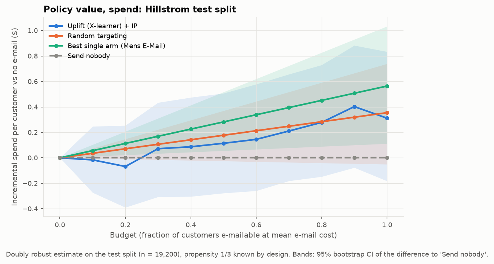
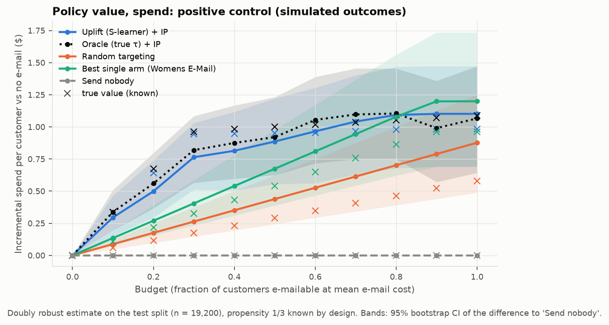
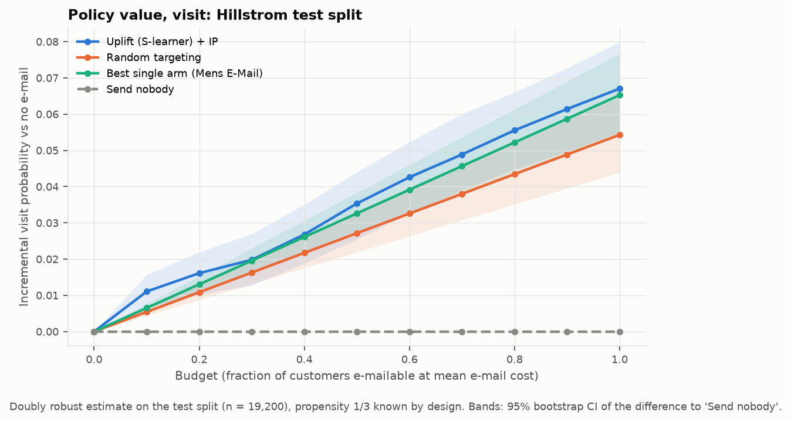
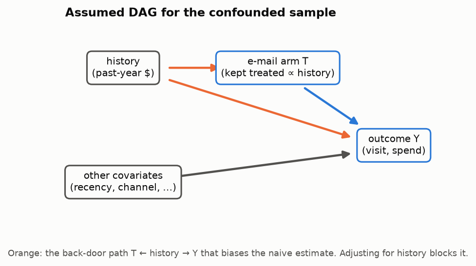

# Budget-constrained promotion targeting from an RCT

**Question.** A retailer can afford to e-mail only some customers, and has two e-mails (Mens, Womens)
of different cost. Can heterogeneous treatment effects estimated from a randomised experiment pick
*who* gets *which* e-mail better than simple rules, at every budget?

**Answer, in two parts.**

1. **On the real Hillstrom data there is no usable targeting signal for spend.** None of five uplift
   learners ranks customers better than random on 2-week spend. The model-targeted policy is
   indistinguishable from random targeting, and its point estimate is *below* the rule "send the Mens
   e-mail to a random subset" at every budget. For **visit** there is a real but small signal. All
   learners rank the Womens-e-mail effect better than random (p = 0.004), and the visit-targeted
   policy beats random targeting at 7 of 10 budgets. It beats the Mens rule at only 1 of 10.
2. **The pipeline would have found a signal if one existed.** As a positive control, I kept the real
   covariates, real arm assignment and real split, and simulated outcomes with a known effect: the
   Womens e-mail adds $3 of expected spend, but only for a segment covering 32% of customers. Noise
   is realistic (1% buy, heavy-tailed amounts). The *unchanged* pipeline then recovers the true effect
   with τ̂–τ correlation 0.62–0.83 for spend and 0.90–0.96 for visit. It beats random targeting at
   8 of 10 budgets for spend and 10 of 10 for visit, and at every budget it reaches 90–98% (spend)
   and 93–99% (visit) of the true value of an oracle policy that knows τ.

So the spend null result is a property of the data, not a blind spot of the method. The optimisation
layer works on both: a Lagrangian heuristic stays within 0.34% of the exact integer program and is
~200× faster at 64k customers.

Pipeline: RCT analysis → CATE/uplift models → allocation under a budget (integer program and
Lagrangian) → off-policy evaluation (IPW and doubly robust). Extensions: semi-synthetic positive
control, deliberate confounding, lower-confidence-bound allocation, and LLM-embedding features.

## Data

[Hillstrom MineThatData e-mail RCT](DATA_CARD.md): 64,000 customers randomised in equal thirds to a
Mens e-mail, a Womens e-mail or no e-mail; outcomes `visit`, `conversion` and `spend` over 2 weeks.
The propensity is 1/3 by design and is used as known everywhere except the confounding extension.
The data is fetched with `scikit-uplift` and checked against the SHA-256 in
[`data/DATA_VERSION.txt`](data/DATA_VERSION.txt). It is split once, 70/30 and stratified by arm,
into train (44,800) and test (19,200). Everything that is fit or selected uses train only.

## Method

| Step | Module | What |
|---|---|---|
| RCT | `rct.py` | SMD balance; difference in means (Welch CI); Lin (2013) regression adjustment / CUPED (HC2); power and MDE |
| CATE | `cate.py`, `metrics.py` | Multi-arm S-, T- and X-learners (LightGBM); EconML DR-learner and CausalForestDML with known propensity; LightGBM tuned by 3-fold CV on train; downstream learner chosen on a train hold-out; Qini/AUUC on test with bootstrap CIs and a permutation-null random baseline |
| Allocation | `allocate.py` | Multiple-choice knapsack: at most one e-mail each, Σ cost ≤ B, maximise Σ τ̂. Exact IP with SCIP (CP-SAT also run); Lagrangian heuristic with λ bisection and a dual bound |
| OPE | `ope.py` | Horvitz–Thompson IPW and doubly robust values with propensity 1/3; paired bootstrap CIs on the test split |
| Positive control | `positive_control.py` | Real X, T and split; simulated `visit`/`spend` with known τ(x, a); same code path as above, plus τ̂–τ correlation, known true policy values and an oracle policy |
| Extensions | `confounding.py`, `robust_allocate.py`, `llm_features.py` | See below |

Assumed costs: Mens $0.10 and Womens $0.08 per e-mail. Budget B = fraction × n × $0.09, so
fraction 1.0 can e-mail everyone at the average cost. All choices are in
[`config/config.yaml`](config/config.yaml) and the reasons in [`DECISIONS.md`](DECISIONS.md). The
positive-control generator was frozen in its own commit before anything ran on it.

## Headline: real data vs positive control

| Real Hillstrom outcomes (spend) | Positive control: known effect (spend) |
|---|---|
|  |  |

Same covariates, same arm assignment, same split, same code. Only the outcomes differ. In the
positive-control panel, × marks the known true value of each policy.

Incremental value per customer vs sending no e-mail, doubly robust, on the test split. Each cell
gives the uplift policy minus random targeting at the same budget, with a paired 95% bootstrap CI
(`policy_differences.csv`, `pc_policy_differences.csv`):

| Budget fraction | Real: spend ($) | Real: visit (pp) | Positive control: spend ($) | Positive control: visit (pp) |
|---:|---:|---:|---:|---:|
| 0.1 | −0.05 [−0.30, 0.21] | +0.56 [0.15, 0.99] | +0.21 [0.06, 0.38] | +0.8 [0.4, 1.2] |
| 0.3 | −0.03 [−0.34, 0.26] | +0.35 [−0.25, 0.97] | +0.50 [0.27, 0.75] | +3.1 [2.5, 3.7] |
| 0.5 | −0.06 [−0.35, 0.22] | +0.82 [0.19, 1.46] | +0.45 [0.17, 0.75] | +3.1 [2.4, 3.7] |
| 1.0 | −0.04 [−0.30, 0.22] | +1.28 [0.61, 1.98] | +0.23 [−0.14, 0.59] | +2.4 [1.8, 3.1] |
| CI > 0, out of 10 budgets | **0** | **7** | **8** | **10** |
| vs best single arm: CI > 0 | **0** | **1** | **4** | **10** |

### Real data in detail

**RCT** (`rct_summary.csv`, all 64,000 rows). Balance is fine: max |SMD| = 0.014 (flag at 0.1).

| Effect vs control | Mens e-mail | Womens e-mail |
|---|---:|---:|
| Spend ($) | +0.77 [0.49, 1.05] | +0.42 [0.17, 0.68] |
| Visit (pp) | +7.7 [7.0, 8.3] | +4.5 [3.9, 5.2] |
| Conversion (pp) | +0.68 [0.50, 0.86] | +0.31 [0.15, 0.47] |

To detect the observed spend effect at 80% power and α = 0.05 you need 5,953 customers per arm for
Mens (range 3,173–14,989 over the effect's CI) and 15,808 for Womens (6,160–99,739). The minimum
detectable effect at the available ~21.3k per arm is $0.41 (Mens) and $0.37 (Womens).

**Uplift models** (`learner_comparison.csv`, `qini_curves*.png`). Qini coefficient on test with
95% bootstrap CIs. The "Random" row is the mean and 95% band of 500 random orderings.

| Learner | Spend: Mens | Spend: Womens | Visit: Mens | Visit: Womens |
|---|---:|---:|---:|---:|
| S | 0.013 [−0.078, 0.103] | −0.005 [−0.079, 0.067] | 0.0004 [−0.0014, 0.0021] | **0.0032 [0.0016, 0.0050]** |
| T | −0.016 [−0.096, 0.057] | 0.010 [−0.068, 0.093] | 0.0005 [−0.0014, 0.0021] | **0.0027 [0.0010, 0.0044]** |
| X | 0.001 [−0.078, 0.080] | 0.010 [−0.065, 0.088] | 0.0001 [−0.0017, 0.0019] | **0.0027 [0.0011, 0.0043]** |
| DR (EconML) | −0.038 [−0.127, 0.042] | 0.026 [−0.056, 0.112] | 0.0000 [−0.0017, 0.0016] | **0.0026 [0.0008, 0.0043]** |
| Causal forest (EconML) | 0.012 [−0.058, 0.100] | 0.024 [−0.054, 0.109] | 0.0006 [−0.0011, 0.0023] | **0.0030 [0.0014, 0.0048]** |
| Random (null band) | −0.005 [−0.086, 0.073] | 0.000 [−0.062, 0.065] | −0.0001 [−0.0019, 0.0019] | 0.0000 [−0.0016, 0.0018] |

The learners selected on train (and used downstream) are X for spend and S for visit.

**Policies** (`policy_values.csv`): incremental value vs no e-mail, DR, 95% CI.

| Budget | Outcome | Uplift + IP | Random targeting | Best single arm (Mens) |
|---:|---|---:|---:|---:|
| 0.3 | spend ($) | 0.07 [−0.31, 0.43] | 0.11 [−0.02, 0.22] | 0.17 [0.03, 0.31] |
| 1.0 | spend ($) | 0.31 [−0.18, 0.83] | 0.35 [−0.05, 0.74] | 0.56 [0.11, 1.03] |
| 0.3 | visit (pp) | 2.0 [1.3, 2.7] | 1.6 [1.3, 1.9] | 2.0 [1.6, 2.3] |
| 1.0 | visit (pp) | 6.7 [5.5, 8.0] | 5.4 [4.4, 6.5] | 6.5 [5.4, 7.7] |



**Allocation solvers** (`allocation_comparison.csv`, `runtime.png`). SCIP proves optimality on all 33
(n, budget) instances. The Lagrangian solution is always feasible, with a gap to the IP of at most
0.34% (n = 1k), 0.17% (10k) and 0.11% (64k). Median solve time at 64k: SCIP 45.6 s vs Lagrangian
0.23 s. These objectives are *predicted* uplift, so they compare solvers, not policies.

### Positive control in detail

Generator (`config.yaml` → `positive_control`, DECISIONS P1–P4):
- Baseline visit and purchase probabilities of 10% and 0.6% rise with log history. This is
  prognostic only, not effect-modifying.
- Spend = purchase × amount, with amount ~ LogNormal(mean $100, σ = 1).
- Mens e-mail: +0.2 pp purchase (+$0.20) and +3 pp visit for everyone.
- Womens e-mail: +3 pp purchase (+$3.00) and +10 pp visit, **only** for `womens == 1 and recency <= 6`
  (32% of customers).
- The simulated test split has a 13.3% visit rate, a 1.0% purchase rate and a mean spend of $1.04,
  close to the real 14.7%, 0.9% and $1.05.

**Recovery of the true τ** (`pc_tau_recovery.csv`, `pc_qini_curves*.png`, `pc_tau_recovery.png`).
For the Womens arm, where the effect is heterogeneous:

| Learner | Qini, spend | corr(τ̂, τ), spend | Qini, visit | corr(τ̂, τ), visit |
|---|---:|---:|---:|---:|
| S | 0.076 [−0.027, 0.164] | 0.83 [0.83, 0.84] | 0.0073 [0.0057, 0.0090] | 0.96 [0.95, 0.96] |
| T | 0.095 [0.019, 0.166] | 0.65 [0.64, 0.66] | 0.0076 [0.0059, 0.0092] | 0.92 [0.92, 0.93] |
| X | 0.100 [0.029, 0.175] | 0.75 [0.74, 0.76] | 0.0074 [0.0057, 0.0090] | 0.94 [0.93, 0.94] |
| DR (EconML) | 0.111 [0.042, 0.178] | 0.62 [0.60, 0.63] | 0.0076 [0.0059, 0.0091] | 0.91 [0.90, 0.92] |
| Causal forest | 0.089 [0.011, 0.167] | 0.65 [0.64, 0.66] | 0.0082 [0.0066, 0.0098] | 0.90 [0.90, 0.90] |
| **Oracle (true τ)** | 0.098 [0.013, 0.171] | 1 | 0.0073 [0.0056, 0.0090] | 1 |
| Random (null band) | 0.002 [−0.076, 0.072] | — | 0.0000 [−0.0017, 0.0015] | — |

All 10 learner × outcome Qinis for the Womens arm beat the permutation null (one-sided p ≤ 0.022)
and are indistinguishable from the oracle's. Only the S-learner's spend bootstrap CI touches 0. On spend, even the oracle's Qini CI is wide, which shows that
sparse purchases are hard to evaluate even with perfect ranking. For the Mens arm the true effect is
constant, so there is nothing to rank: every learner *and the oracle* have Qini ≈ 0, as they should.
The τ–τ̂ correlation is undefined for spend there, because τ is constant.

**Policies** (`pc_policy_values.csv`). At budget 0.3, the spend-targeted policy is worth $0.76
[0.51, 1.03] per customer (true value $0.95) against $0.82 for the oracle (true $0.96), $0.26 for
random targeting (true $0.17) and $0.41 for Womens to a random subset (true $0.32). Measured by the
known true values, the uplift policy reaches 90–98% of the oracle's value for spend and 93–99% for
visit at every budget (`pc_policy_values.csv`, column `true_incremental`).

**Estimator calibration against the known truth.** The DR 95% CI covers the true policy value in
73 of 80 (budget × policy × outcome) cases (IPW: 74/80). All 7 misses are visit, at budgets 0.4–0.9,
for the oracle or uplift policy, and overestimate by about 0.9 pp. Those policies e-mail almost the
same customers, so the misses are not independent: they reflect one test-sample draw about 2 SE
above expectation, not estimator bias. The unit tests confirm unbiasedness on fresh draws.

## Negative results (kept on purpose)

1. **No learner beats random targeting on real spend.** All 10 learner × arm Qini CIs contain 0 and
   every one-sided permutation p-value is ≥ 0.24. For conversion, one of 10 comparisons (S-learner,
   Mens) gives p = 0.028, which is unremarkable after multiple testing. CV tuning picked the
   most-regularised corner of the grid, which is itself a sign of little signal.
2. **On real data the uplift policy does not beat a one-line rule.** On spend it is below "Mens e-mail
   to a random subset" at every budget (all paired CIs contain 0). On visit, where a real ranking
   signal exists, it beats the rule only at budget 0.1 (+0.45 pp [0.05, 0.87]). The Mens e-mail is
   simply better on average, and the heterogeneity that is there (in the Womens arm) is too small
   to change that.
3. **Real-data signal ≠ policy gain.** The visit Qini for the Womens arm is clearly non-zero, but it
   only translates into beating *random* targeting, not the best fixed arm. A non-zero Qini is not
   enough to justify a targeting system.
4. **Regression adjustment barely helps.** The CUPED/Lin adjustment narrows the spend CI by only 0.1%
   (visit: 1.5%), because pre-period covariates explain almost none of 2-week spend.
5. **Allocating on a lower confidence bound is worse, not safer** (`robust_allocation.csv`).
   Using the 10th percentile of τ̂ over 50 bootstrap refits lowers both the mean and the
   5th-percentile policy value at every budget. For example, at fraction 0.5 the mean is
   $0.12 → $0.02 and the 5th percentile is −$0.23 → −$0.31.
6. **LLM embeddings add nothing** (`llm_features.csv`). Adding 8 PCA components of `all-MiniLM-L6-v2`
   embeddings of a one-sentence customer description changes test Qini by +0.019 [−0.042, 0.081]
   (Mens) and −0.022 [−0.052, 0.010] (Womens). The sentence renders the same tabular covariates.
7. **CP-SAT is the wrong exact solver here.** It finds no feasible solution within 30 s for 9 of 10
   non-zero budgets at n = 10k, while SCIP solves 64k in under 70 s (DECISIONS D14).
8. **The best positive-control learner for ranking is badly calibrated.** The S-learner, selected on
   train for spend, ranks the segment correctly but shrinks its effect: median τ̂ is $1.3 in the
   segment vs the true $3.0 (`pc_tau_recovery.png`). This is fine for allocation, which only needs
   the ordering, but τ̂ should not be read as a dollar forecast.

## Confounding extension



Keeping every control but treated customers with probability sigmoid(1.5 · z(log history)) creates
the back-door path T ← history → Y. On **visit** (`confounding.csv`), the naive difference in means
overstates the ATE by +1.8 pp (Mens; 9.4% [8.6, 10.3] vs RCT 7.7%) and +1.4 pp (Womens). Both naive
CIs exclude the RCT value. IPW with an estimated multinomial-logit propensity and AIPW (DR) recover
it to within 0.2 pp: Mens DR 7.8% [6.9, 8.7], Womens DR 4.7% [3.9, 5.6]. On **spend** the selection
bias is buried in noise, as anticipated (DECISIONS D18).

## Limitations

- **SUTVA.** E-mails are assumed not to affect other customers (no household spill-over, no
  cannibalisation between customers).
- **Single-period effects.** Outcomes cover 2 weeks after one campaign (2008). The policy value
  ignores long-run effects, fatigue and unsubscribes, and the effects may not transport to today.
- **Cost assumptions.** Hillstrom has no cost data, so the $0.10 / $0.08 e-mail costs are invented.
  The objective is incremental revenue or visits, not profit, and costs only enter through the
  budget.
- **The positive control is only as realistic as its generator.** The effect is additive, the
  segment is a simple rule on two observed covariates (easy for trees), and amounts are independent
  of X. Real heterogeneity may be smoother, weaker or driven by unobserved factors. The control shows
  the pipeline *can* find a $3, 32%-of-customers effect at this noise level, not that it would find
  any effect.
- **Evaluation noise dominates on spend.** With 19,200 test customers, spend policy-value CIs are
  about ±$0.4 per customer, the same order as the effects. A real deployment would need a larger,
  or prospective, test.
- **Intervals.** Qini/AUUC and policy-value CIs resample test rows with fixed models, so they ignore
  model-refit variance. The allocation runtime comparison is a deterministic benchmark on predicted
  τ̂ and has no CI. Several comparisons across budgets and outcomes are reported without
  multiplicity correction; read single borderline CIs accordingly.
- **Criteo scale check not run**: all known download URLs return 404 (DECISIONS D21).

## How to reproduce

Python ≥ 3.11 (developed on 3.12, Windows 11). On Windows without GNU make, use `mingw32-make`.

```bash
python -m venv .venv && . .venv/bin/activate   # Windows: .venv\Scripts\activate
make install     # pip install -e ".[dev,llm]"   (the llm extra pulls in torch, for one extension)
make quick       # whole pipeline, 50 bootstrap reps, into results/quick/   (~15 min on 16 cores)
make all         # full run, 500 reps, regenerates results/                  (~45 min on 16 cores)
make test        # pytest: every estimator tested on simulated data with a known effect
```

`make quick` is meant for reviewers. It runs every step with 50 bootstrap reps, 10 robust refits and
a smaller solver benchmark, and writes to `results/quick/` without touching the committed results.
`python -m uplift_alloc.run_all --only positive_control` reruns a single step. Use `--keep-cache` to
reuse cached predictions and embeddings.

## Repository map

```
config/config.yaml         all analysis choices (fixed before test results; later changes in DECISIONS.md)
src/uplift_alloc/          library: data, rct, cate, metrics, allocate, ope, positive_control,
                           confounding, robust_allocate, llm_features, run_all, plotting, config
scripts/download_data.py   fetch + validate + hash + split + DATA_CARD.md
tests/                     pytest suite (simulated ground truth for every estimator)
results/{figures,tables}/  generated outputs (pc_* = positive control)
DATA_CARD.md  DECISIONS.md  TODO.md
```

## CV bullet

> Built a reproducible causal decision pipeline on a 64k-customer e-mail RCT (uplift learners →
> budget-constrained integer program → doubly robust off-policy evaluation). I showed that the real
> data has no targetable spend signal (model-targeted −$0.04/customer vs random, 95% CI −0.30 to
> 0.22), while a semi-synthetic positive control on the same covariates is recovered (τ̂–τ correlation
> up to 0.83; +$0.50 [0.27, 0.75] vs random at 30% budget). A Lagrangian heuristic matched the exact
> IP to within 0.34% at ~200× the speed.
